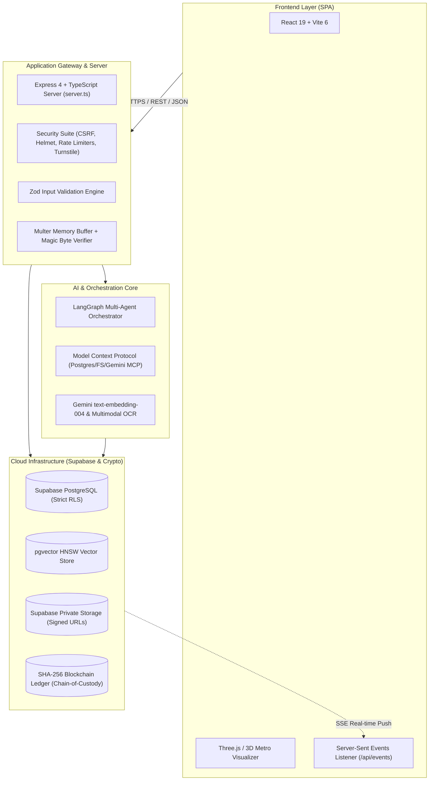
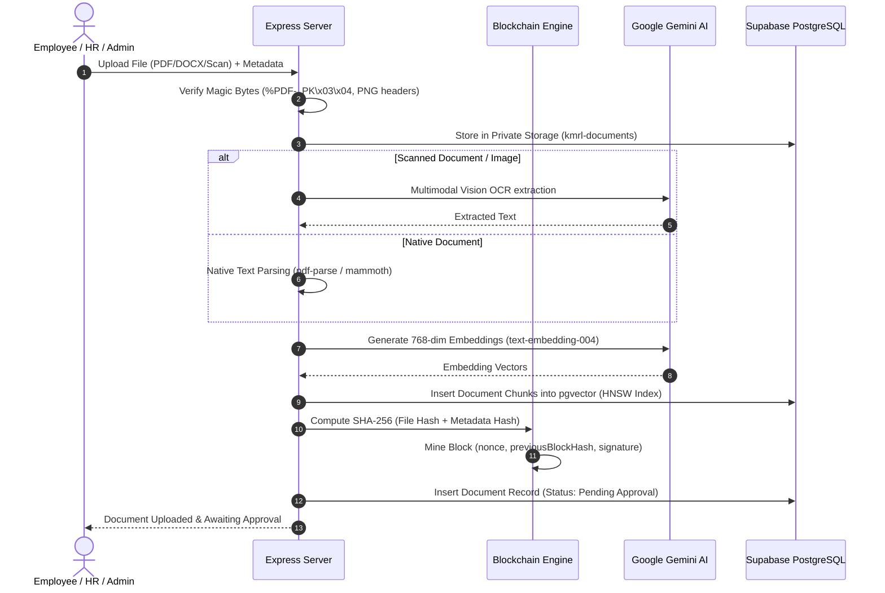
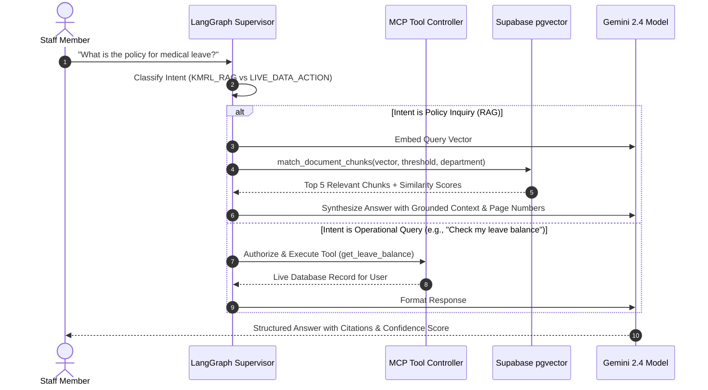

# 🚇 KMRL Intelligent Document Management System (IDMS)
### *Enterprise Document Management, pgvector RAG & Tamper-Evident Chain-of-Custody*

[](https://www.typescriptlang.org/)
[](https://react.dev/)
[](https://vitejs.dev/)
[](https://nodejs.org/)
[](https://supabase.com/)
[](https://ai.google.dev/)
[](https://tailwindcss.com/)

---

## 📌 Executive Overview

The **KMRL Intelligent Document Management System (IDMS)** is an enterprise-grade document repository and employee operations portal built for **Kochi Metro Rail Limited (KMRL)**. Incorporating **e-CASEVAULT**-grade security standards, the platform pairs modern cloud infrastructure with **AI-driven semantic retrieval (RAG)**, **cryptographic blockchain verification**, and **strict Role-Based Access Control (RBAC)**.

All documents (PDFs, DOCX, scans, HR circulars, engineering tenders) are parsed, chunked, embedded via Google Gemini into Supabase `pgvector`, and secured in private storage buckets with temporary signed URLs and immutable blockchain block signatures.

---

## 🏛️ System Architecture

The platform operates on a decoupled, secure, multi-tier enterprise architecture:



---

## ⚙️ How It Works (End-to-End System Workflows)

### 1. Document Ingestion, OCR & AI RAG Pipeline


1. **Upload & Magic-Byte Validation**: The server validates file signatures using binary magic numbers (preventing extension spoofing).
2. **Text Extraction & AI OCR**: Native text is extracted with `pdf-parse` or `mammoth`. Low-quality or scanned files trigger Google Gemini Multimodal Vision OCR.
3. **Chunking & Vectorization**: Extracted text is segmented into overlapping semantic chunks and embedded with `text-embedding-004` (768 dimensions).
4. **pgvector Storage**: Vectors are committed into Supabase PostgreSQL indexed with HNSW for sub-second cosine distance search (`<=>`).
5. **Blockchain Hashing**: The file content and metadata are hashed with SHA-256 and sealed into an immutable block.
6. **Approval Workflow**: The document remains `Pending Approval` until reviewed by HR or Admin.

---

### 2. AI Helpdesk & Multi-Agent Assistant Workflow


---

### 3. Leave Management & Atomic Deductions
1. **Application**: An employee submits a leave request specifying leave type (Casual, Sick, Earned), date range, and reason (with optional medical certificate upload).
2. **Atomic Balance Lock**: When an HR Specialist or Admin approves the leave, the database executes the stored procedure `approve_leave_application`:
   - Uses `SELECT ... FOR UPDATE` to lock both the leave request and the employee's balance row.
   - Verifies the employee has sufficient remaining days.
   - Deducts `used_days` atomically in a single ACID transaction.
   - Writes an immutable record to `public.audit_logs`.
3. **Live Sync**: The status change is broadcast via Server-Sent Events (SSE), immediately refreshing the employee's UI.

---

### 4. Cryptographic Blockchain Chain-of-Custody
- Every document upload generates an immutable block linked to the previous block hash:
  $$\text{BlockHash} = \text{SHA256}(\text{BlockNum} : \text{Timestamp} : \text{DocID} : \text{FileHash} : \text{MetaHash} : \text{PrevHash} : \text{Nonce})$$
- Administrators can visit the **Blockchain Ledger** view and trigger an on-demand audit. The system iterates through every block, recalculates hashes from raw data, and flags any tampered file or modified ledger block.

---

## 👥 Role-Based Access Control (RBAC): Who Got Which Access

The system enforces strict multi-tier permissions at **three independent levels**:
1. **Frontend Navigation**: UI tabs and buttons are hidden or disabled based on user role.
2. **API Middleware**: Express routes reject unauthorized roles with `403 Forbidden` (`requireRole(['Admin', 'HR'])`).
3. **Database RLS**: Supabase PostgreSQL Row Level Security enforces database-level isolation even if the server is bypassed.

### 📋 Detailed Permissions & Feature Matrix

| Feature / Module | 🛡️ Administrator (`Admin`) | 👩‍💼 HR Specialist (`HR`) | 👨‍💼 Employee (`Employee`) | Security Enforcement |
| :--- | :---: | :---: | :---: | :--- |
| **System Dashboard** | Full KPIs, operations overview | HR KPIs & Pending counts | Personal KPIs & Quick links | Frontend UI conditional |
| **Document Library (Approved)** | ✅ View & Download all | ✅ View & Download all | ✅ View & Download all | Database RLS policy |
| **Document Library (Pending)** | ✅ View & Review all | ✅ View & Review all | 🔒 View own uploads only | Database RLS policy |
| **Upload Documents** | ✅ Upload any category | ✅ Upload any category | ✅ Upload allowed categories | API validation & RLS |
| **Approve / Reject Documents** | ✅ Full approval authority | ✅ Full approval authority | ❌ No Access | `requireRole(['Admin', 'HR'])` |
| **Delete Documents** | ✅ Full delete authority | ❌ No Access | ❌ No Access | `requireRole(['Admin'])` |
| **AI Helpdesk (RAG Search)** | ✅ Unlimited queries | ✅ Unlimited queries | ✅ Unlimited queries | Token rate-limited |
| **AI MCP Tools (Directory/Stats)** | ✅ All tools authorized | ✅ All tools authorized | 🔒 Scoped to own data | MCP Permission Matrix |
| **Apply for Personal Leave** | ✅ Yes | ✅ Yes | ✅ Yes | Authenticated user |
| **Approve / Reject Staff Leaves** | ✅ Full approval authority | ✅ Full approval authority | ❌ No Access | Stored procedure check |
| **Adjust Employee Quotas** | ✅ Full quota control | ✅ Full quota control | ❌ No Access | RLS & Role check |
| **View Immutable Audit Logs** | ✅ Full access to all logs | ❌ No Access | ❌ No Access | Database RLS policy |
| **Export Audit Logs (CSV / Print)** | ✅ Full export rights | ❌ No Access | ❌ No Access | Restricted to Admin |
| **Blockchain Chain Audit** | ✅ View & trigger audit | ❌ No Access | ❌ No Access | Admin verification engine |
| **Operations Analytics & Reports** | ✅ View all system metrics | ✅ View HR & staff metrics | ❌ No Access | `requireRole(['Admin', 'HR'])` |
| **Staff Directory** | ✅ Manage, view & invite | ✅ View staff records | 🔒 View sanitized directory | Database RLS policy |
| **Register / Invite New Staff** | ✅ Create user profiles | ❌ No Access | ❌ No Access | `requireRole(['Admin'])` |
| **Update Own Profile Photo** | ✅ Yes | ✅ Yes | ✅ Yes | `id === auth.uid()` |

---

### 👤 User Persona Journeys

#### 👨‍💼 1. The Employee Journey
* **Daily Goal**: Find metro procedures, submit shift reports, review personal leaves.
* **Workflow**:
  1. Logs in and views their personal dashboard showing remaining leave balance and recent circulars.
  2. Uses **Helpdesk Assistant** to ask: *"What are the safety guidelines for Track Inspection during monsoon?"* The AI responds instantly with excerpts and page numbers from official approved manuals.
  3. Uploads a vendor invoice or medical certificate. The document is scanned, hashed into the blockchain, and submitted for approval.
  4. Submits a 2-day leave request. Receives an instant notification when HR reviews it.

#### 👩‍💼 2. The HR Specialist Journey
* **Daily Goal**: Review documents, approve leave applications, monitor departmental staffing.
* **Workflow**:
  1. Opens the **Approvals** tab, which displays a badge count of all pending submissions.
  2. Inspects newly uploaded employee files, previews them using secure short-lived URLs, and approves or rejects with review notes.
  3. Navigates to **Leave Requests** to review pending applications. Approves a request, automatically deducting quota and updating company records.
  4. Accesses **Reports & Analytics** to examine leave trends and document submission velocities.

#### 🛡️ 3. The Administrator Journey
* **Daily Goal**: Complete system governance, user provisioning, evidence security, and compliance audits.
* **Workflow**:
  1. Oversees the entire portal with administrative privileges.
  2. Creates new employee profiles with designated roles (`Admin`, `HR`, `Employee`) and departmental assignments.
  3. Reviews the **Activity Logs** tab to monitor every system action (who logged in, which document was downloaded, IP addresses).
  4. Opens the **Blockchain Ledger** and clicks **"Verify Ledger Integrity"** to execute a cryptographic proof validating that zero documents have been tampered with or modified out-of-band.

---

## 💻 Technology Stack

### **Frontend (Client SPA)**
* **Framework**: [React 19](https://react.dev/) + [Vite 6](https://vitejs.dev/) with TypeScript
* **Styling**: [Tailwind CSS v4](https://tailwindcss.com/) + custom dark/light metro design tokens
* **3D Visualizations**: [Three.js](https://threejs.org/), [@react-three/fiber](https://r3f.docs.pmnd.rs/), [@react-three/drei](https://github.com/pmndrs/drei)
* **Icons & Animation**: [Lucide React](https://lucide.dev/), [Motion](https://motion.dev/)
* **Real-time Synchronization**: Native Browser `EventSource` (Server-Sent Events) connected to backend database triggers

### **Backend (API Gateway & Server)**
* **Runtime**: [Node.js](https://nodejs.org/) (ESM + CommonJS build target via `esbuild`)
* **Web Framework**: [Express 4](https://expressjs.com/) with TypeScript
* **File Processing**: [Multer](https://github.com/expressjs/multer) (25MB in-memory buffers), [pdf-parse](https://www.npmjs.com/package/pdf-parse), [mammoth](https://www.npmjs.com/package/mammoth) (DOCX parser)
* **Validation**: [Zod](https://zod.dev/) schemas covering every inbound payload
* **Security Middleware**: [Helmet](https://helmetjs.github.io/), double-submit CSRF token validation, IP-scoped rate-limiters, and Cloudflare Turnstile token verification

### **Database & Cloud Storage (Supabase)**
* **Relational Database**: [Supabase PostgreSQL](https://supabase.com/docs/guides/database)
* **Vector Database**: `pgvector` with HNSW cosine-distance indexing for sub-second semantic RAG lookups
* **Row Level Security (RLS)**: Enforced policies across all 10+ relational tables
* **File Storage**: Private Supabase Storage bucket (`kmrl-documents`) accessible strictly via short-lived signed URLs (120-second TTL)
* **Zero Secret Leakage**: The `SUPABASE_SERVICE_ROLE_KEY` is loaded strictly on the Node.js server and never exposed to the client bundle

### **Artificial Intelligence & RAG**
* **LLM & Vision**: [Google Gemini 2.4](https://ai.google.dev/) (`@google/genai`) for document question answering, summary generation, and multimodal OCR on low-contrast scans
* **Embeddings**: Gemini `text-embedding-004` producing 768-dimensional dense vectors
* **Agent Framework**: [LangChain](https://js.langchain.com/) & [LangGraph](https://langchain-ai.github.io/langgraphjs/) multi-agent supervisor graph
* **Model Context Protocol (MCP)**: Custom MCP server implementation supporting Postgres MCP, Filesystem MCP, and Gemini tool calling

### **Evidence Integrity & Chain-of-Custody**
* **Engine**: Custom SHA-256 Merkle-linked blockchain ledger (`server/blockchainEngine.ts`)
* **Features**: Block hashing, nonce generation, validator signatures, and one-click tamper detection audit tool

---

## 📂 Project Directory Structure

```plaintext
kmrl-intelligent-document-management-system/
├── assets/                     # Static media and brand assets
├── data/                       # Local disk storage & fallback cache
├── public/                     # Public client assets (KMRL logo, icons)
├── server/                     # Backend Server & Domain Logic
│   ├── agentOrchestrator.ts    # LangGraph multi-agent supervisor
│   ├── blockchainEngine.ts     # SHA-256 chain-of-custody ledger
│   ├── dbService.ts            # Supabase PostgreSQL database service
│   ├── mcpServer.ts            # Model Context Protocol tools & permission matrix
│   ├── persistentStore.ts      # Local persistence fallback layer
│   ├── ragEngine.ts            # text-embedding-004 + pgvector search + OCR
│   ├── securityMiddleware.ts   # CSRF, Helmet, rate-limiters, magic bytes
│   ├── supabaseClient.ts       # Supabase Admin client & signed URL generator
│   └── validation.ts           # Zod schemas for all API payloads
├── src/                        # Frontend React 19 Client
│   ├── components/             # Modular UI view components
│   │   ├── AIChatbotView.tsx   # AI Assistant & LangGraph interface
│   │   ├── AnalyticsView.tsx   # Dashboard analytics & charts
│   │   ├── ApprovalWorkflowView.tsx # Document review queue
│   │   ├── AuditLogsView.tsx   # Filterable audit log & CSV exporter
│   │   ├── BlockchainLedgerView.tsx # Tamper-evident ledger auditor
│   │   ├── DashboardView.tsx   # Main portal dashboard
│   │   ├── DocumentLibraryView.tsx  # Document management & upload modal
│   │   ├── LeaveManagementView.tsx  # Leave applications & balances
│   │   ├── LoginView.tsx       # 3D Metro scene login screen
│   │   ├── MetroScene.tsx      # Three.js 3D train animation
│   │   ├── Navbar.tsx          # Navigation header & notifications
│   │   └── ProfileView.tsx     # Staff directory & user settings
│   ├── types.ts                # TypeScript data interfaces & types
│   ├── App.tsx                 # Root application controller & SSE stream
│   └── main.tsx                # React DOM entry point
├── supabase/
│   └── schema.sql              # Hardened PostgreSQL schema (RLS, pgvector, RPCs)
├── .env.example                # Template for environment configuration
├── package.json                # Dependencies, build scripts & engine configs
├── tsconfig.json               # TypeScript compiler rules
├── vercel.json                 # Vercel deployment configuration
└── vite.config.ts              # Vite + TailwindCSS build configuration
```

---

## ⚙️ Environment Configuration

Create a `.env` file in the root directory modeled after `.env.example`:

```env
# ============================================================================
# 1. Supabase PostgreSQL & Private Storage Configuration (Required)
# ============================================================================
SUPABASE_URL="https://your-project-id.supabase.co"
SUPABASE_ANON_KEY="your-anon-public-key"
SUPABASE_SERVICE_ROLE_KEY="your-service-role-secret-key"

# ============================================================================
# 2. Google Gemini API (Required for RAG & Multimodal OCR)
# ============================================================================
GEMINI_API_KEY="your-gemini-api-key"

# ============================================================================
# 3. Security & App Server Configuration
# ============================================================================
PORT=3000
NODE_ENV="development"
APP_ORIGINS="http://localhost:3000,http://127.0.0.1:3000,https://your-dms.vercel.app"
TRUST_PROXY="1"

# ============================================================================
# 4. Cloudflare Turnstile Bot Protection (Optional in dev, recommended in prod)
# ============================================================================
TURNSTILE_SITE_KEY="your-site-key"
TURNSTILE_SECRET_KEY="your-secret-key"
```

---

## 🛠️ Local Development Setup

### **Prerequisites**
* [Node.js](https://nodejs.org/) v18.0.0 or higher
* npm or bun
* A free or paid [Supabase](https://supabase.com) project
* A [Google AI Studio Gemini API Key](https://aistudio.google.com/)

### **1. Clone & Install Dependencies**
```bash
git clone <repository-url>
cd kmrl-intelligent-document-management-system
npm install
```

### **2. Setup Database Schema**
1. Open your Supabase Dashboard.
2. Navigate to the **SQL Editor**.
3. Open [`supabase/schema.sql`](supabase/schema.sql), paste the entire script, and click **Run**.
4. In the **Storage** section, create a bucket named `kmrl-documents` with Public Access **Disabled**.

### **3. Start Development Server**
```bash
npm run dev
```
Open [http://localhost:3000](http://localhost:3000) in your browser. The Express server boots with Vite in middleware mode for hot module replacement (HMR).

---

## 🚢 Production Deployment

### **Option 1: Deploy on Vercel**
The repository includes a ready-to-use [`vercel.json`](vercel.json):
1. Push your code to GitHub or GitLab.
2. Log in to [Vercel](https://vercel.com) and click **"Add New Project"**.
3. Select your repository.
4. Set the Build Command to `npm run build` and Output Directory to `dist`.
5. Under **Settings > Environment Variables**, add:
   - `SUPABASE_URL`
   - `SUPABASE_ANON_KEY`
   - `SUPABASE_SERVICE_ROLE_KEY`
   - `GEMINI_API_KEY`
   - `NODE_ENV=production`
6. Click **Deploy** to receive your permanent live link (e.g., `https://kmrl-dms.vercel.app`).

### **Option 2: Deploy on Render / Railway / Docker**
Because Express natively serves both the compiled Vite frontend from `dist/` and all `/api/*` endpoints on a single port:
```bash
# Production Build
npm run build

# Start Production Server
npm start
```
Configure your web service start command to `npm start` and configure the environment variables in your hosting provider's dashboard.

---

## 🔒 Security Best Practices

1. **Keep Service Role Key Confidential**: Never add `SUPABASE_SERVICE_ROLE_KEY` to client-side code or public repositories.
2. **Signed Storage URLs Only**: All documents are downloaded and previewed via time-limited signed URLs that expire after 120 seconds.
3. **Audit Immutability**: All modifications and access attempts are recorded to the append-only `public.audit_logs` table.
4. **Tamper Detection**: Use the Blockchain Ledger audit tool to cryptographically confirm file integrity against Merkle-hashed blocks.

---

## 📄 License & Attribution

Designed and maintained for **Kochi Metro Rail Limited (KMRL)** operations. Built with Google Gemini, React, Express, and Supabase.
